import { VideoEmbed } from "@site/src/components/VideoEmbed";
import { Note } from "@site/src/components/Note";

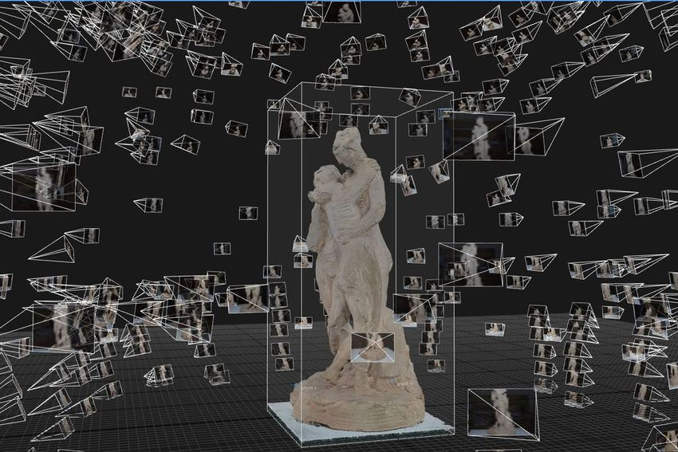

Una larga clase de visión artificial.

<!-- truncate -->

## Introducción

A los humanos nos gusta capturar y retratar el mundo que nos rodea. En
[SIMBOLOS](https://linternita.com/blog/simbolos), una anterior publicación de
esta editorial, vimos como este pasatiempo es algo que venimos acarreando desde
que nos resguardábamos en cuevas.

Mucho hemos avanzado desde aquellas épocas. Dejamos atrás las paredes de una
cueva y el uso de pigmentos que hallábamos tirados por ahí (como el ocre) para
reemplazarlos por... papiros, murales, frescos, mosaicos, pinturas al óleo... un
sinfín de medios y técnicas distintas.

La progresión no fue lineal ni siempre significó un avance en nuestra habilidad
de representar objetivamente nuestro mundo, ya que el arte humano nunca estuvo
únicamente enfocado en ese objetivo. El arte transmite un significado, un
mensaje que muchas veces no concuerda con la realidad percibida por nuestros
ojos.

Sin embargo, nos _gusta_ retratar la realidad tal percibimos, tanto así que
eventualmente surgió una corriente
[realista](<https://en.wikipedia.org/wiki/Realism_(arts)>), donde el arte se
enfocaba en representar al sujeto/materia _tal cual_ es, sin exagerarlo, ni
añadir elementos artificiales.

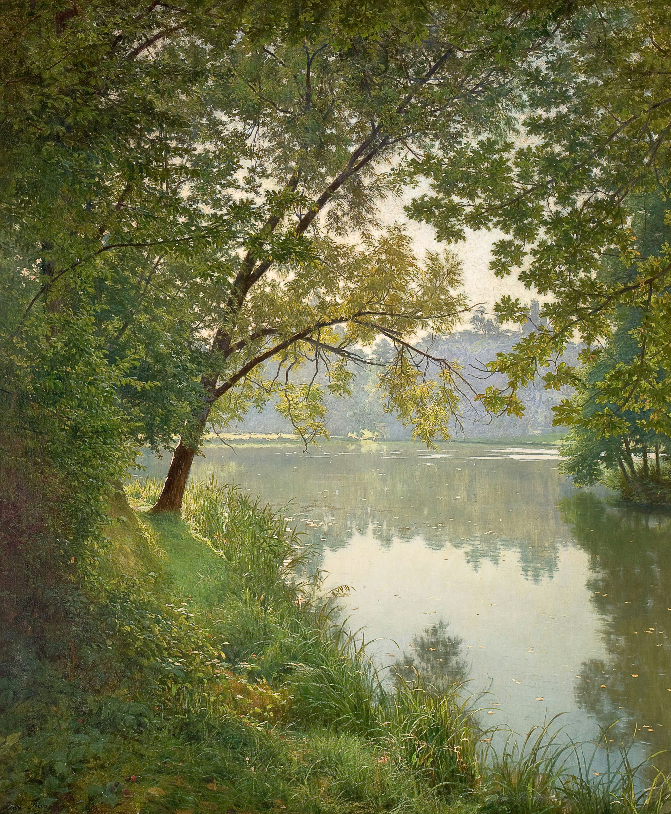

_Figura 1: Matin à Villeneuve, Henri Biva, una pintura realista_

Hará unos doscientos años atrás, comenzamos a desarrollar un artefacto capaz de
crear imágenes a través de la captura de rayos de luz: la cámara.

Dicha habilidad provee a las cámaras de una cualidad fundamental: un verdadero
realismo. La fotografía producida por una cámara describe la escena capturada de
la forma más realista posible.[1](#note-1)

<Note noteIndex="1">
  La fotografía también es otro medio artístico, y como mencionamos
  anteriormente, el arte no siempre está enfocado en representar objetivamente
  al mundo que nos rodea. Más aún, existen distintos tipos de sensores, lentes y
  técnicas que alteran la forma en que una cámara captura rayos de luz,
  produciendo imágenes visualmente distintas de una misma escena, que quizás no
  correspondan con aquello que percibimos con nuestros dos ojos.
</Note>

Parece ser que las cualidades de la cámara calaron hondo en nuestra psiquis: nos
_desvivimos_ por capturar la realidad. Es un deseo tan embebido en nuestras
mentes que, a día de hoy, uno de los dispositivos más vendidos hasta la fecha y
que casi todo el mundo lleva en sus bolsillos cuentan no con una, sino con
_múltiples_ cámaras por defecto.

_Realmente_ nos gusta capturar la realidad que nos rodea.

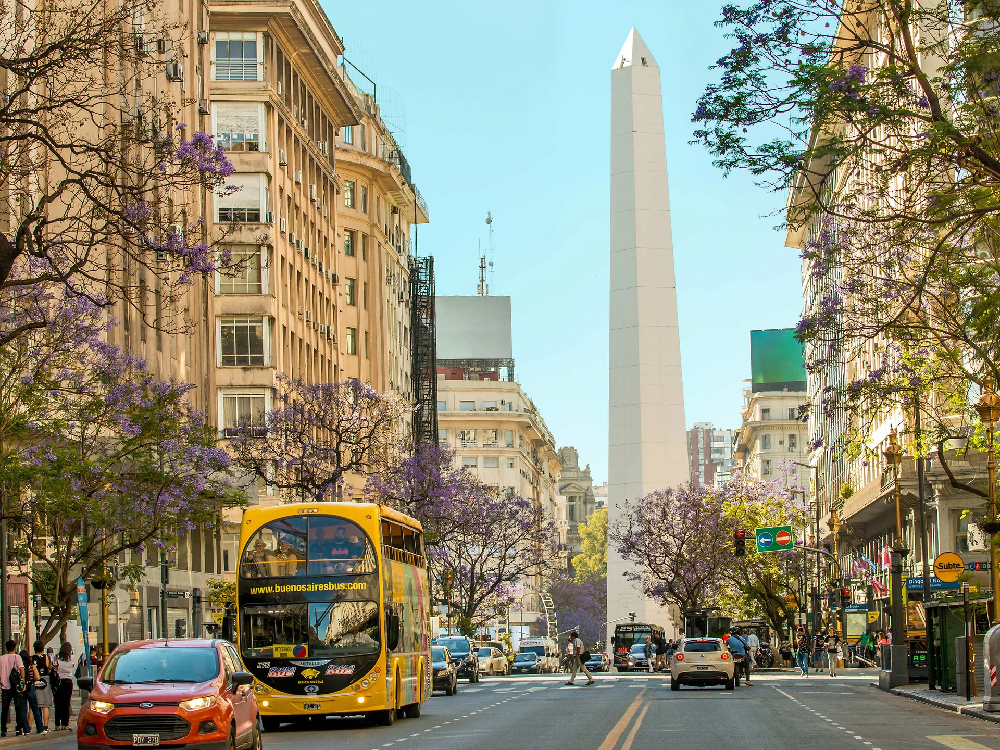

Pero... por mucho que las fotografías nos acerquen bastante a una representación
objetiva de la realidad, tienen un gran problema: son imágenes bidimensionales,
siendo nuestro mundo tridimensional.

## Reconstruyendo la tridimensionalidad en base a fotografías

Si bien una fotografía puede transmitirte una sensación de profundidad, lo
cierto es que no la tiene. Por ejemplo, la siguiente foto hace un buen uso de la
perspectiva, haciéndonos sentir que los pedazos de hielo se encuentran bien
cerca nuestro y que los árboles están bastante lejos en la distancia.

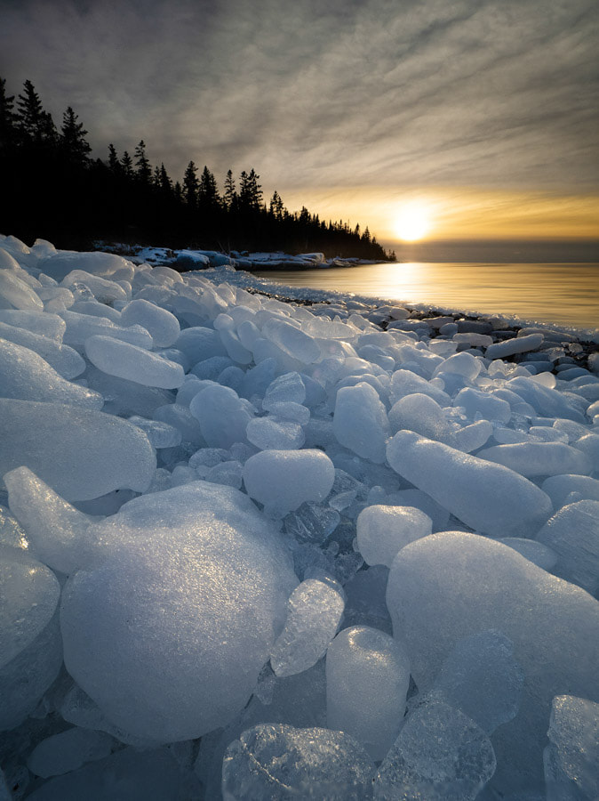

Pero es solo una sensación. La imagen en sí _no captura_ ningún tipo de
información relacionada a la distancia o profundidad de las cosas. Al ser un
plano bidimensional esa información se pierde.

Tangencialmente... nuestros ojos son solo capaces de "capturar imágenes en 2D".
Sin embargo, nuestro cerebro es capaz de utilizar distintas técnicas para
"reconstruir la tridimensionalidad", tales como la disparidad binocular
(contamos con dos ojos frontales, levemente distanciados el uno del otro, lo que
produce que se proyecten imágenes diferentes en nuestras retinas; en base a esas
imágenes, nuestro cerebro es capaz de triangular con gran precisión qué tan
distantes se encuentran los objetos que observamos), paralaje de movimiento
(cuando te movés, los objetos cercanos aparentan moverse más rápido que aquellos
que se encuentran muy lejos), diferencias de tamaño (los objetos cercanos
aparentan ser más grandes), ocultamiento (si un objeto bloquea parcialmente a
otro, percibimos que el objeto que bloquea es más cercano), sombras,
perspectiva, entre muchas otras.

Así como nuestro cerebro es capaz de reconstruir la tridimensionalidad, existen
técnicas de
[visión artificial](https://es.wikipedia.org/wiki/Visi%C3%B3n_artificial)
capaces de generar un modelo tridimensional en base a imágenes bidimensionales.
En las siguientes secciones vamos a ver algunas.

## Fotogrametría

Citando al libro Introduction to Modern Photogrammetry, la fotogrametría:

> ha sido definida como el proceso de derivar información (usualmente) métrica
> acerca de un objeto, a través de las mediciones realizadas sobre fotografías
> del objeto.
>
> [...]
>
> La tarea fundamental de la fotogrametría consiste en establecer rigurosamente
> la relación geométrica entre la imagen y el objeto tal cual existía al momento
> de ser tomada la imagen. Una vez que esta relación es recuperada
> correctamente, uno puede derivar información acerca del objeto estrictamente
> desde la imagen capturada.

La fotogrametría puede utilizarse para generar una reconstrucción tridimensional
de un objeto utilizando fotografías del mismo. Pero antes de hablar de eso,
quiero aclarecer lo siguiente: no es la única cosa que se puede hacer con "la
fotogrametría".

¿Por qué esta aclaración? Porque si buscamos información en, digamos, Google,
casi todas las páginas dicen que la fotogrametría es un método para reconstruir
estructuras tridimensionales usando imágenes bidimensionales. **NO.** Eso es
algo que podemos hacer con técnicas de fotogrametría moderna, pero no es lo
único que se puede hacer, ni es a lo que la disciplina apunta de forma
exclusiva.

La fotogrametría tiene diversos productos, entre ellos:

- Creación de mapas que muestran la elevación de contornos, terrenos, y
  estructuras hechas por humanos
- Mapas ortomosaicos[2](#note-2) (mapas fotográficos en donde todos
  los elementos están en la misma escala, libre de errores y deformaciones)
- Información espacial para sistemas de información geográfica (GIS)
- Y por supuesto, la representación tridimensional de objetos, que es el
  producto más popular de la fotogrametría hoy en día

<Note noteIndex="2">de qué te reís inmaduro</Note>

### El método fotogramétrico, en líneas generales

En la siguiente imagen de una caja encontramos resaltados dos puntos, P y Q.

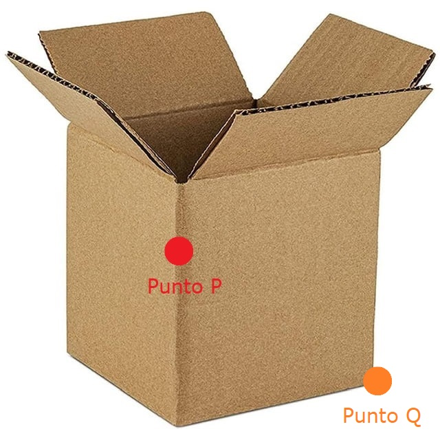

Esta imagen/fotografía es en términos geométricos un plano. Si posicionáramos un
sistema de coordenadas en un punto arbitrario de la imagen, el mismo contaría
con solo dos ejes (X e Y).

Bajo este esquema, hallar las coordenadas de los puntos es algo trivial. P se
encuentra en (Px, Py) y Q se encuentra en (Qx, Qy).

Pero como aludimos anteriormente, con una sola imagen es imposible determinar la
profundidad de los puntos, nos sería imposible obtener una coordenada Z.

Para resolver esto necesitamos información extra. Esa información puede estar en
la imagen misma (por ejemplo, posicionando la caja cerca de algún objeto de
referencia que tenga dimensiones conocidas), o tomando múltiples fotografías de
la caja desde posiciones distintas.

Con tan solo contar con dos fotografías tomadas desde posiciones distintas ya
poseemos la información necesaria para _triangular_ la profundidad de un punto
en relación con la cámara:

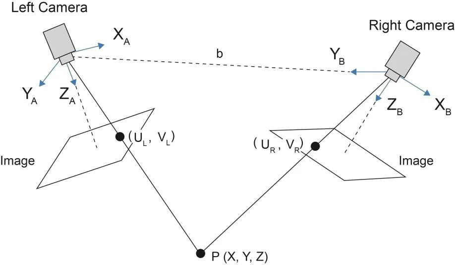

De esta forma somos capaces de obtener las coordenadas 3D de cualquier punto que
sea de nuestro interés.

Una vez que obtenemos las coordenadas de varios puntos podemos representarlos en
un modelo tridimensional. Por cuestiones relacionadas con los algoritmos
involucrados y a las restricciones impuestas por cómo las imágenes son
digitalizadas[3](#note-3), _no hacemos_ esto para los infinitos
puntos que conforman nuestro objeto, lo que nos da como resultado una
representación inexacta del mismo, conocida como **nube de puntos dispersa**.

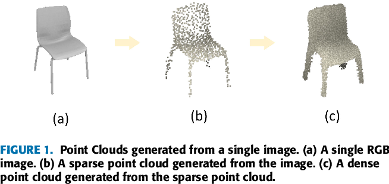

<Note noteIndex="3">

En la vida real, la caja está compuesta por "infinitos" puntos. Pero las
imágenes que tomás con una cámara están atadas a la resolución de la misma. Una
cámara que capture imágenes en Full HD produce una matriz de 1920 × 1080 =
2.073.600 píxeles, siendo éste el máximo valor de "puntos" que podrías detectar.

Pero es complejo desarrollar un algoritmo de visión artificial que sea capaz de
_detectar_ todos los puntos pertenecientes a un objeto. La mayoría de los
algoritmos de detección de puntos se enfocan en detectar cambios "locales"
dentro de un área de píxeles (por ejemplo, una intersección en donde los píxeles
cambien de color o intensidad drásticamente). Si tenés una zona donde no hay
cambios notables (como lo sería en el caso de, no sé, sacarle una foto a una
pared blanca impoluta), los algoritmos no van a ser capaces de detectar puntos.

</Note>

La nube de puntos dispersa nos da una idea de la geometría general del objeto,
pero no tiene un gran nivel de detalle ni nos sirve para hacer una
reconstrucción 3D del mismo. Por lo tanto, el siguiente paso consiste en generar
todavía más puntos, para así obtener una **nube de puntos densa**.

Esta nube sí cuenta con un alto nivel de detalle, pudiendo contener billones de
puntos asociados al objeto. El problema es que sigue siendo solamente una
representación basada en puntos desconectados. Para que sea realmente un modelo
3D, los puntos tienen que estar conectados entre sí de alguna forma (utilizando
triángulos, o líneas, o polígonos en general). Si quisiéramos hacer una
impresión 3D del objeto en base a la nube de puntos densa, no podríamos.

Así que para solucionar esto, conectamos los puntos (generalmente usando
triángulos/polígonos), obteniendo como resultado una malla poligonal:

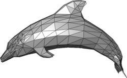

El último paso consiste en "pintar" este modelo 3D. Hay varias formas de
hacerlo, pero si queremos una representación "foto-realística", lo que se hace
es proyectar las fotografías que tomamos del objeto sobre la malla.

### Estereofotogrametría

La estereofotogrametría es una técnica de triangulación de puntos/reconstrucción
3D que utiliza cámaras estereoscópicas, que son, básicamente, cámaras que poseen
dos lentes/sensores levemente separados.

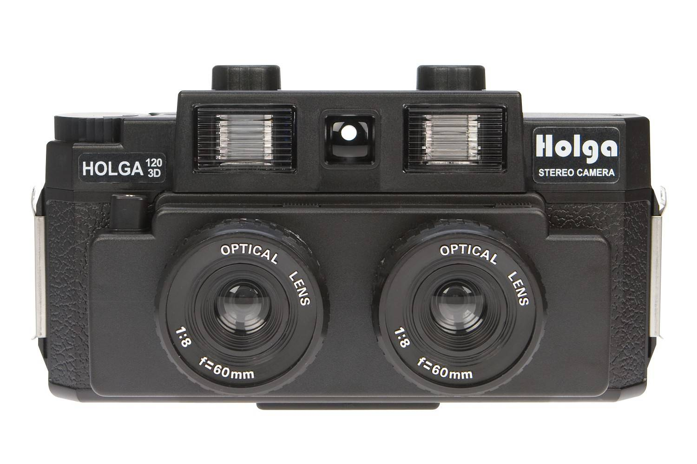

El hecho de tener dos sensores separados significa que la cámara es capaz de
simular la visión binocular que poseemos los humanos. La separación de cada
sensor produce una disparidad binocular, es decir: el par de fotografías
capturado por la cámara en un instante dado tiene diferencias entre sí.

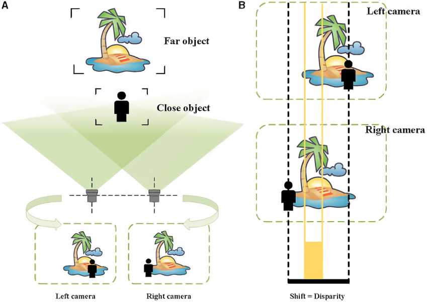

Además, esta disposición de los sensores es útil ya que sabemos:

- que ambos apuntan hacia la misma dirección,
- no existe rotación entre sensor y sensor,
- no hay diferencia de profundidad (Z) ni de altura (Y),
- solamente existe un desplazamiento horizontal (X) el cual conocemos/es
  fácilmente medible.

Estas propiedades simplifican la triangulación, reduciendo el cálculo geométrico
necesario a la siguiente ecuación:

  $\ Z = \frac{f * B}
  {d}$

donde:

- f es la distancia focal de la cámara, obtenida a través de calibrar la
  cámara[4](#note-4)
- B es la base, es la distancia entre "sensor y sensor"
- d es el valor de disparidad (la diferencia entre la coordenada X del punto en
  cada imagen)

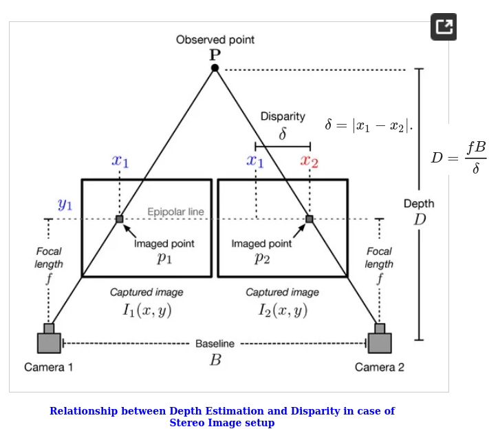

<Note noteIndex="4">

¿Calibrar la cámara?

Esto puede sonar como un proceso físico en el que le hacés _algo_ a la cámara, a
su lente, o sensor. En realidad, no, es un proceso matemático donde se calculan
algunos parámetros conocidos como parámetros intrínsecos y extrínsecos de la
cámara.

Los parámetros extrínsecos determinan la _pose_ de la cámara (posición y
orientación), mientras que los intrínsecos definen cómo el lente de la cámara
distorsiona los rayos de luz, la distancia focal (separación entre el lente y el
sensor), y el punto principal de la cámara (el "centro" de la imagen).

</Note>

Usando un setup estéreo, el proceso de calcular la profundidad de un punto de
nuestro interés es fácil y rápido. No solo eso, sino que el resultado provisto
por esta técnica se encuentra en una escala métrica (es decir, desde el vamos,
en la nube de puntos las distancias corresponden con aquellas del mundo real).

La gran desventaja que posee esta técnica es el hecho de tener que armar o
conseguir una cámara estéreo y realizar la calibración de la misma previamente a
obtener las coordenadas 3D de los puntos.

### Structure from Motion (SfM)

La estereofotogrametría funciona y a día de hoy sigue siendo utilizada, pero...
conseguir o armar una cámara estereoscópica es algo molesto. Hasta hace pocos
años no era común disponer de dispositivos con más de un lente (hoy en día
nuestros celulares poseen varios; aún así, son lentes/sensores con propiedades
distintas).

También nos demanda conocer ciertos parámetros de la cámara (intrínsecos y
extrínsecos). En muchos casos disponemos de una gran colección de fotografías
donde no sabemos nada acerca de la cámara que fue utilizada, por lo que no
disponemos de dichos parámetros.

En los años 70 surgieron algunas publicaciones en las que se proponían métodos y
algoritmos para poder reconstruir una escena 3D utilizando fotografías tomadas
con cámaras convencionales (es decir, de un solo lente, monoculares). A
diferencia de la estereofotogrametría, que se basa en el concepto de visión
binocular, estas técnicas se basan en la interpretación del movimiento en cada
fotografía (más específicamente, en el efecto conocido como _paralaje de
movimiento_):

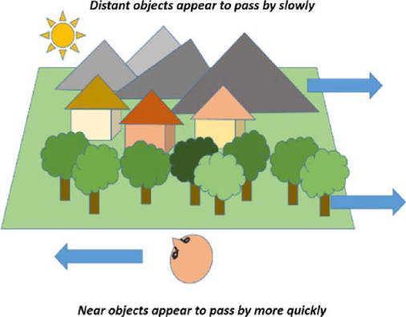

De ahí surge el nombre "Structure from Motion": a través de analizar el
movimiento de la cámara alrededor de una escena se puede generar una estructura
3D que la represente.

Esto, en los años 70, era _posible_ de hacer... con bastante dificultad. Un par
de décadas después, llegando al nuevo milenio, hubo una explosión de métodos y
técnicas relacionadas a visión artificial que resultaron ser bastante útiles
para automatizar el proceso.

¿Lo más interesante? Gracias a esas técnicas, **SfM puede reconstruir una escena
3D sin conocer la pose de la cámara ni ninguno de sus parámetros.**

El siguiente gráfico muestra los pasos asociados al método SfM moderno, los
cuales iremos explicando a continuación.

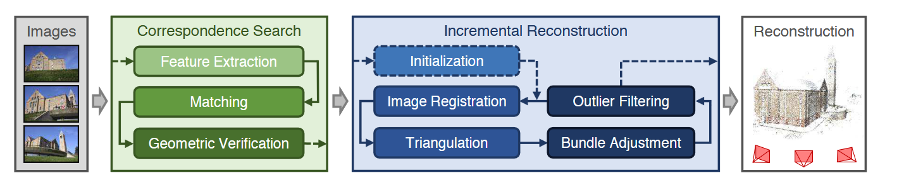

#### 1. Tomado de fotografías

Si bien SfM levanta el requeimiento de tener una cámara estereoscópica, esto no
quiere decir que pueda reconstruir una escena 3D a partir de una sola imagen.
Uno de los pasos involucrados dentro del método es la triangulación (¿de qué
otra forma, si no?), por lo que necesitamos muchas imágenes desde distintos
puntos de vista.

Estas imágenes tienen que tener _bastante_ solapamiento entre sí. Con
solapamiento nos referimos a que, entre dos pares de imágenes consecutivas, lo
que se "ve" en cada una de ellas debe ser _bastante_ similar (no exactamente lo
mismo, porque si no no agregamos información nueva, pero no pueden ser imágenes
totalmente distintas).

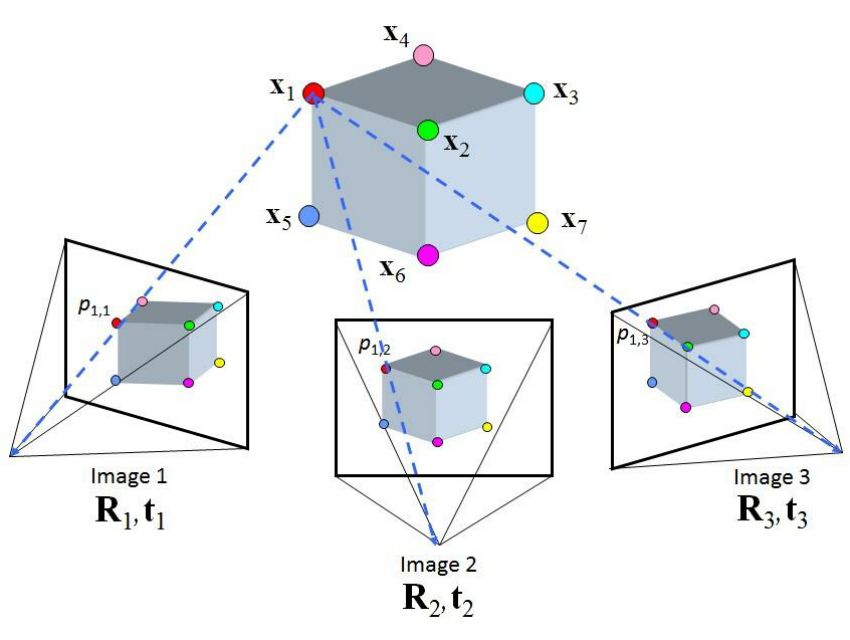

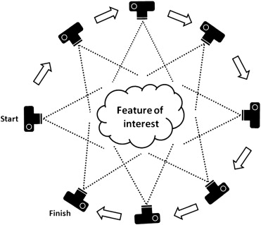

No es necesario que tomemos las fotos en un orden específico o que las ordenemos
previamente a ejecutar SfM. El método se encarga de detectar pares de imágenes
con alto solapamiento y luego los utiliza para estimar las coordenadas 3D de los
puntos visualizados en esos pares.

#### 2. El problema de la correspondencia de puntos

En este post venimos hablando hace rato de puntos. No debería sorprender que uno
de los pilares fundamentales del funcionamiento de SfM gire en torno a ellos.

El primer paso que realiza el método es la extracción de características de las
imágenes.

_¿Qué es una característica?_

Buenísima pregunta. No hay una definición concreta.

En sí, las características de una imagen son partes "interesantes". Por ejemplo,
un área donde tengas la intersección de píxeles de distintos colores. Una imagen
totalmente blanca carece de características (o puntos notables, o keypoints, se
usan distintos nombres de forma intercambiable para referirse a lo mismo; en
esta publicación voy a usar estos tres indistintamente).

Hay _varios_ algoritmos para detectar características (keypoints) en una imagen,
[SIFT](https://en.wikipedia.org/wiki/Scale-invariant_feature_transform),
[FAST](https://en.wikipedia.org/wiki/Features_from_accelerated_segment_test),
[ORB](https://en.wikipedia.org/wiki/Oriented_FAST_and_rotated_BRIEF), entre
otros. No todos funcionan de la misma forma y algunos son bastante enrevesados.

El siguiente gráfico es una comparativa de los resultados que producen distintos
algoritmos sobre la misma imagen:

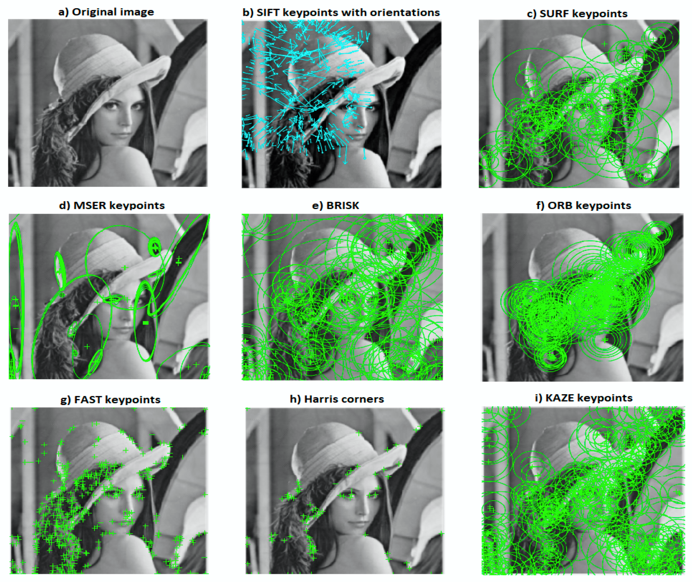

Para no dejar totalmente en el aire cómo funcionan estos algoritmos, vamos a
explicar muy por encima FAST. FAST, _muy por encima_, se centra en detectar
esquinas. Cada esquina detectada es guardada como un keypoint.

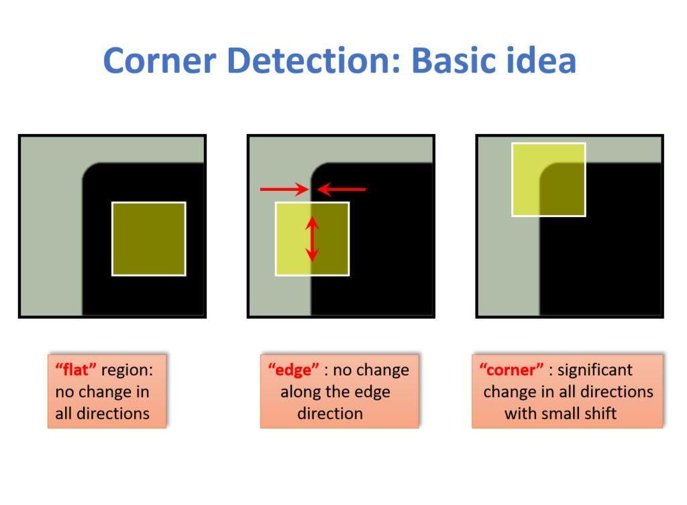

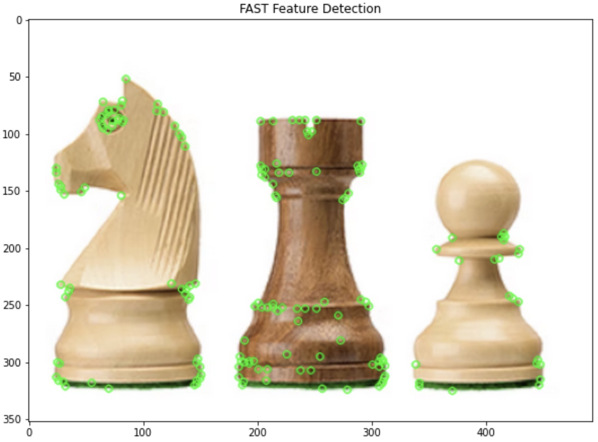

Una vez que han sido detectadas todas las características en las imágenes, se
empieza a "resolver" el problema de la correspondencia de puntos. En sí, el
problema de puntos se puede entender en base al siguiente enunciado:

**Dadas dos imágenes A y B con sus respectivos puntos notables, ¿qué puntos de A
encontramos en B?**

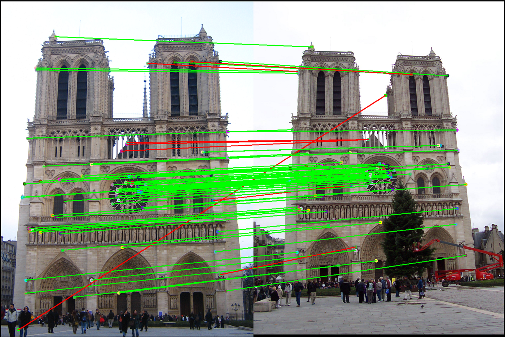

SfM realiza este proceso para identificar imágenes que estén viendo la misma
escena/área. Como resultado obtenemos un conjunto de pares de imágenes
_potencialmente_ se solapan.

Luego se debe validar que dichos pares de imágenes realmente estén viendo la
misma escena. Esto es porque el paso anterior solamente se fija en la apariencia
de los keypoints para decir que dos puntos en imágenes distintas son en realidad
el mismo, lo cual puede ser erróneo. Para eliminar outliers y correspondencias
incorrectas, se utiliza el método RANSAC.

#### Reconstrucción incremental: inicialización, triangulación, registro de imágenes

Hablamos bastante de la detección de puntos, pero, ¿de qué nos sirve conocer la
ubicación del mismo punto en diferentes imágenes?

Pista

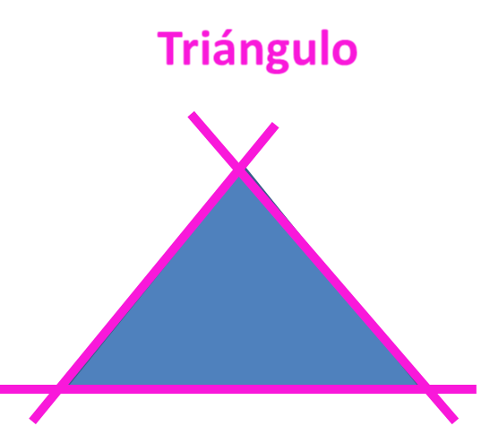

Otra vez caemos en triangulación, pero hay un problema grave: **¿cómo carajo
triangulamos si no conocemos las posiciones de la cámara en cada foto tomada?**

Recordemos que SfM no necesita ningún tipo de información previa, solo las
fotos. Resolver el problema de la correspondencia nos indica que estamos
observando el mismo punto desde vistas distintas. Pero no tenemos ningún marco
de referencia que nos diga dónde estaba ubicada la cámara en cada una de esas
vistas.

En una cámara estéreo, conocemos de antemano la posición de una cámara respecto
a la otra: sabemos que se encuentran únicamente desplazadas en un solo eje. En
SfM, entre foto y foto, la cámara puede haberse desplazado de cualquier forma
(varios ejes, rotación incluida), o incluso puede que estés lidiando con
fotografías tomadas con cámaras diferentes (distintos parámetros intrínsecos).

Para resolver este problema, SfM estima la pose de la cámara. Existen diferentes
algoritmos para lograr este cometido, todos ellos utilizan las correspondencias
detectadas en el paso anterior:

- El algoritmo de Nistér (conocido como
  [five point algorithm](https://hyunlibro.com/en/posts/academic/5point-algorithm))
- [Eight point algorithm](https://en.wikipedia.org/wiki/Eight-point_algorithm)
- Estimación de pose basada en homografía

Me encantaría explicar estos algoritmos, pero van más allá de esta publicación
(y de mi conocimiento). En definitiva, nos ayudan a obtener la posición de la
cámara solo utilizando puntos 2D.

Para empezar a triangular, se elige un par de imágenes iniciales (que, por
ejemplo, tengan bastantes correspondencias 2D entre sí), se ejecuta alguno de
los algoritmos previamente mencionados para estimar la pose de la cámara, y por
último, se triangula, obteniendo así un conjunto de puntos 3D iniciales.

Una vez obtenidos los puntos 3D iniciales, podemos comenzar a procesar nuevas
imágenes para incluirlas en nuestro modelo. Este proceso se llama "registro" de
imágenes. Para registrar nuevas imágenes no hace falta que ejecutemos nuevamente
algoritmos como el de Nistér. Todavía _necesitamos_ estimar la pose de la
cámara, pero podemos hacerlo resolviendo el problema de "Perspectiva desde n
Puntos". Este problema estima la pose de la cámara utilizando _n_ puntos 3D y
sus correspondientes proyecciones 2D en una imagen.

Al añadir nuevas imágenes podemos nuevamente triangular para obtener la posición
3D de otros puntos notables (que quizás no eran visibles en el par de imágenes
iniciales), expandiendo así el modelo tridimensional.

#### Bundle adjustment

El último paso (de este ciclo iterativo) es realizar lo que se conoce como
[_bundle adjustment_](https://en.wikipedia.org/wiki/Bundle_adjustment). Esta
técnica refina los parámetros (intrínsecos y extrínsecos) de la cámara y las
coordenadas 3D de los puntos obtenidos.

En sí, es un problema de
[_optimización matemática_](<https://es.wikipedia.org/wiki/Optimizaci%C3%B3n_(matem%C3%A1tica)>)
donde se intenta minimizar el error de reproyección.

_¿Qué es el error de reproyección?_

Supongamos que en una imagen nos centramos en un punto notable _q_. Disponemos
para esa misma imagen los parámetros estimados de la cámara C, y un punto X que
representan las coordenadas 3D del punto _q_.

Usando la matriz de la cámara C y el punto X, podemos obtener una ecuación de
proyección. Esta ecuación de proyección arroja un punto _p_ 2D en nuestra
imagen.

El error de reproyección es la diferencia entre el punto _q_ y el punto _p_. Si
la estimación fuese buena, la diferencia entre ambos puntos debería ser mínima.
Caso contrario tenemos que refinar los parámetros a fin de minimizar el
error.[5](#note-5)

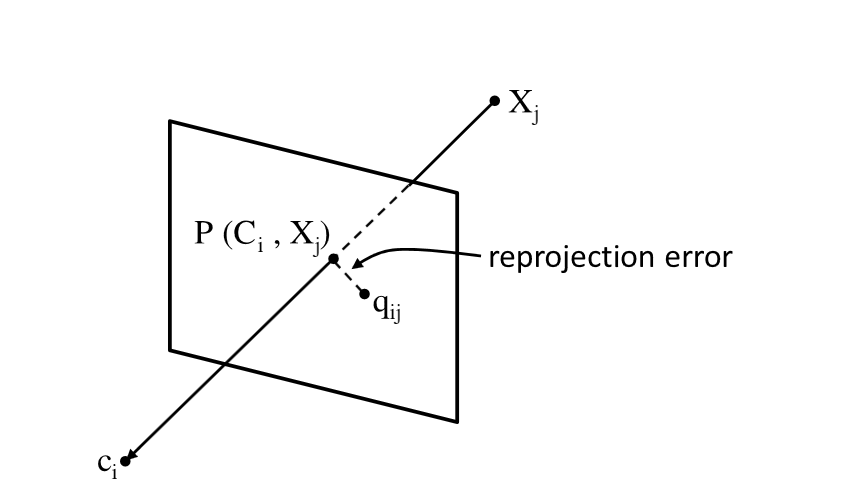

<Note noteIndex="5">
En el
[capítulo 3.2 de esta tésis](https://www.cs.cornell.edu/~snavely/publications/thesis/thesis.pdf)
se explica más a fondo cómo se obtiene la ecuación de proyección y qué función se optimiza.

No te preocupes si no entendés esto. Yo tampoco. Para entenderlo completamente
no solo necesitás tener conocimiento de álgebra, geometría, óptica de cámaras...
sino también de un montón de algoritmos relacionados a visión artificial.

</Note>

#### El resultado

Al final de todo este proceso, obtenemos una nube de puntos dispersa con la
estimación de las distintas poses la cámara en la escena.

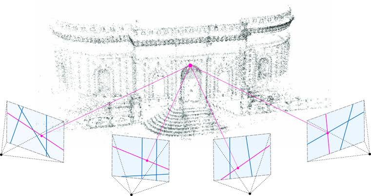

### Multi-View Stereo (MVS)

El siguiente paso es obtener la nube de puntos densa. Para esto se utiliza una
técnica conocida como Multi-View Stereo (MVS).

MVS utiliza los resultados producidos por SfM: la nube de puntos y las
estimaciones intrínsecas e extrínsecas de la cámara para cada imagen.

A diferencia de SfM donde solo nos centrábamos en hallar coordenadas 3D para las
características (puntos notables), MVS calcula la profundidad para casi todos de
los píxeles de la imagen.

El resultado que obtenemos de MVS es la nube de puntos
densa.[6](#note-6)

<Note noteIndex="6">
Voy a ser sincero. Mi idea era explicar cada paso involucrado hasta la creación del modelo 3D final. Pobre de mí, tan ingenuo.

No es tan fácil como parece y me cuesta bastante entender y destilar el
conocimiento. Probablemente lo siga explicando en futuras publicaciones, pero
por ahora terminamos el tema acá.

Lo que sigue después de la línea de puntos densa es generar la malla poligonal y
pintarla, y ahí tenés el modelo 3D resultante.

</Note>

## NeRF y Gaussian Splatting

NeRF (Neural radiance field) y Gaussian Splatting son técnicas relativamente
nuevas que pueden reconstruir una escena 3D a partir de imágenes.

NeRF apareció en 2020 impulsado por los avances en deep learning y redes
neuronales. Si bien funciona, debido a que está basado en redes neuronales
resulta bastante lento.

Gaussian Splatting apareció en 2023 y le pasó el trapo a NeRF en cuanto a
velocidad, principalmente porque no utiliza redes neuronales sino que está
basado en "gaussian blobs".

Ambas técnicas se benefician de SfM, ya que necesitan la estimación de
parámetros de la cámara para funcionar.

Mi intención es explicar estas dos técnicas en siguientes publicaciones, pero si
no podés esperar, mira estos videos de Computerphile:

<VideoEmbed src="https://www.youtube.com/embed/wKsoGiENBHU" />

<VideoEmbed src="https://www.youtube.com/embed/VkIJbpdTujE" />

## Referencias

- [Introduction to Modern Photogrammetry - Edward M. Mikhail](https://books.google.com.ar/books/about/Introduction_to_Modern_Photogrammetry.html?id=D4h8EAAAQBAJ&redir_esc=y)
- [Introduction to ortho mapping - Arcgis](https://doc.esri.com/en/arcgis-pro/latest/help/data/imagery/introduction-to-ortho-mapping.html)
- [Photogrammetry - Ocean Explorer NOAA](https://oceanexplorer.noaa.gov/technology/photogrammetry/)
- [Introduction to Photogrammetry - T. Schenk](https://dl1.icdst.org/pdfs/files/1a3dacb48e4ca6bbc936ce9eaf029a36.pdf)
- [Photogrammetry and Structure-from-Motion](https://ecampusontario.pressbooks.pub/remotesensing/chapter/chapter-10-photogrammetry-and-structure-from-motion/)
- [‘Structure-from-Motion’ photogrammetry: A low-cost, effective tool for geoscience applications](https://www.sciencedirect.com/science/article/pii/S0169555X12004217)
- [Chapter 1 - Structure from motion photogrammetric technique](https://www.sciencedirect.com/science/chapter/bookseries/abs/pii/B9780444641779000011)
- [Structure-From-Motion Revisited](https://openaccess.thecvf.com/content_cvpr_2016/papers/Schonberger_Structure-From-Motion_Revisited_CVPR_2016_paper.pdf)
- [Scene reconstruction and visualization from internet photo collections](https://www.cs.cornell.edu/~snavely/publications/thesis/thesis.pdf)
- [Two-View Geometry](https://www.3dflow.net/elementsCV/S4.xhtml)
- [Multi-View Stereo](https://computervisiononline.com/explains/multi-view-stereo/)
