import { VideoEmbed } from "@site/src/components/VideoEmbed";
import { Note } from "@site/src/components/Note";

el mundo actual es un desastre, ¿qué mejor forma de escapar que perder el tiempo
leyendo sobre posibles futuros distantes?

<!-- truncate -->

## Estructura del post

Todos los libros presentados en esta publicación se encuadran bajo el género de
ciencia ficción. Así como en el género, en esta lista vas a encontrar un poco de
todo: exploración espacial, robótica, viajes en el tiempo, universos paralelos,
distopías, imperios intergalácticos...

El orden de presentación de cada libro carece de significado. Cada libro estará
acompañado de una (pobre[1](#note-1)) sinopsis la cual no contendrá
spoilers, y, como considero que es mejor adentrarse sin saber nada en absoluto,
será presentada de esta forma:

Sinopsis

para que puedas evitarla si no querés conocer nada del libro de antemano

Además, estará acompañado de una breve opinión mía diciendo lo mucho que me
gustó el libro.

<Note noteIndex="1">
  Las sinopsis son escritas por mí. Podría copiarlas de algún lado, como
  Goodreads, ¿pero qué gracia tiene?
</Note>

## Alastair Reynolds

### Pushing Ice

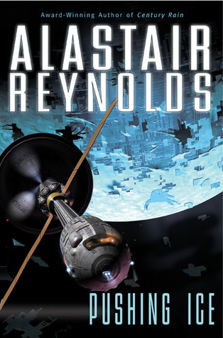

> _We push ice. It's what we do._

:::tip[Opinión]

No sé por dónde empezar. Es uno de los mejores libros de ciencia ficción que leí
últimamente, y eso que pasó tiempo ya.

La trama me absorbió completamente. Creo que hasta soñé con el libro. Al
terminarlo quería más. Lamentablemente (aún) no hay más.

**LINTER-PUNTAJE:** le doy 5 linternas de 5 🔦🔦🔦🔦🔦

:::

Sinopsis

La tripulación de la nave espacial _Rockhopper_ se encarga de "empujar hielo".
Básicamente, minan hielo de cometas y lo transportan a la Tierra (o donde se
necesite, la verdad no me acuerdo).

Finalizando una operación de minado reciben un mensaje: Janus, una de las lunas
de Saturno, se sale de su órbita y empieza a acelerar _con todo_, dirigiéndose
hacia fuera del sistema solar.

_Rockhopper_ es la nave más cercana a Janus en ese momento. A la tripulación se
la asigna la tarea de perseguir a la misteriosa luna y descubrir el misterio
alrededor de la misma.

[Pushing Ice en Goodreads](https://www.goodreads.com/book/show/89186.Pushing_Ice)

### House of Suns

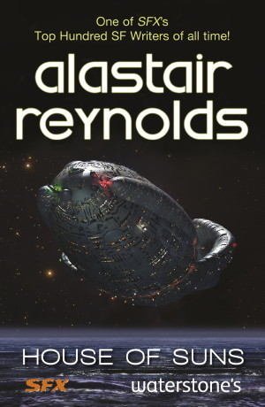

> _I was a girl then, a single individual called Abigail Gentian._

:::tip[Opinión]

Terminar Pushing Ice dejó un hueco con forma de libro en mi corazón. Para
intentar llenarlo, decidí leer House of Suns, otro libro del mismo autor, que no
tiene nada que ver con Pushing Ice (no es una secuela ni continuación).

Mi línea de pensamiento fue "Pushing Ice es cocaína para mí, seguramente sus
otros libros también sean igual de buenos".

Temo decir que, si bien House of Suns es un excelente libro que también me gustó
mucho... es muy difícil reemplazar a la cocaína.

**LINTER-PUNTAJE:** le doy 4 linternas de 5 🔦🔦🔦🔦

:::

Sinopsis

Millones de años en el futuro, la vía láctea se encuentra controlada por
distintas "líneas": dinastías enteras compuestas únicamente por clones del
fundador original.

El libro se enfoca en la Línea Gentian, compuesta por Abigail Gentian y sus 999
clones (de los cuales una mitad son hombres; la otra mitad, mujeres).

Cada cierto tiempo, la dinastía entera se reúne. En la última reunión de los
Gentian ocurre un atentado que casi elimina a la Línea por completo. Los clones
sobrevivientes intentan descubrir por qué y quién está detrás del ataque.

[House of Suns en Goodreads](https://www.goodreads.com/book/show/1126719.House_of_Suns)

## Peter F. Hamilton

### Pandora's Star & Judas Unchained

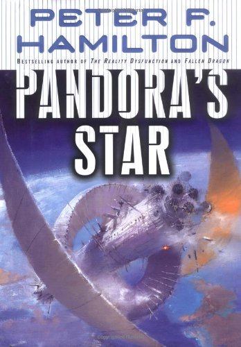

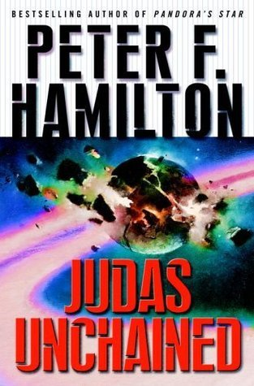

> _‘That’s why I’m here,’ Paula said. ‘To make sure it won’t happen again.’_

:::tip[Opinión]

Pandora's Star y Judas Unchained son en sí un solo libro, pero que lo dividieron
en dos porque el autor no paraba de escribir boludeces que a nadie le importa en
vez de centrarse en la historia.

No jodo cuando digo que, llegando al final del libro y en medio de un momento
intenso, el tipo se pone a describir la vegetación al lado de una ruta. Por
varias páginas. Son libros increíblemente densos y largos.

Además de eso, algunos personajes femeninos están muy, muy mal escritos. En
criollo, Peter Hamilton es un pajero.

Pero dejando de lado lo malo, las partes buenas son _muy_ buenas. El
"world-building" es fenomenal, la trama es atrapante, y le perdono todo al autor
por introducir a Paula Myo, el mejor personaje del mundo ❤️❤️❤️❤️

**LINTER-PUNTAJE:** les doy 4 linternas de 5 🔦🔦🔦🔦

:::

Sinopsis

En un futuro cercano, dos locos descubren cómo abrir agujeros de gusano y
usarlos como "portales".

Muchos, muchos años después, la tecnología de la humanidad avanzó de forma
exponencial (en gran parte gracias a los agujeros de gusano): morir es cosa del
pasado, la Tierra ya no es nuestra única casa, los humanos pueden ponerse
"insertos" y "tatuajes" que mejoran sus habilidades y sentidos, y por supuesto,
descubrimos que no somos los únicos que viven en la galaxia.

De la nada, dos estrellas lejanas desaparecen casi instantáneamente,
oscureciéndose completamente. Observaciones hechas por un astrónomo revelan que
las estrellas fueron "envueltas" por una esfera. ¿Quién provocó eso? ¿Qué
especie es lo suficientemente avanzada como para envolver completamente no solo
una, sino dos estrellas? ¿Por y para qué? ¿Matará la curiosidad al gato?

[Pandora's Star en Goodreads](https://www.goodreads.com/book/show/45252.Pandora_s_Star)

[Judas Unchained en Goodreads](https://www.goodreads.com/book/show/45244.Judas_Unchained)

## Adrian Tchaikovsky

### Children of Time (serie)

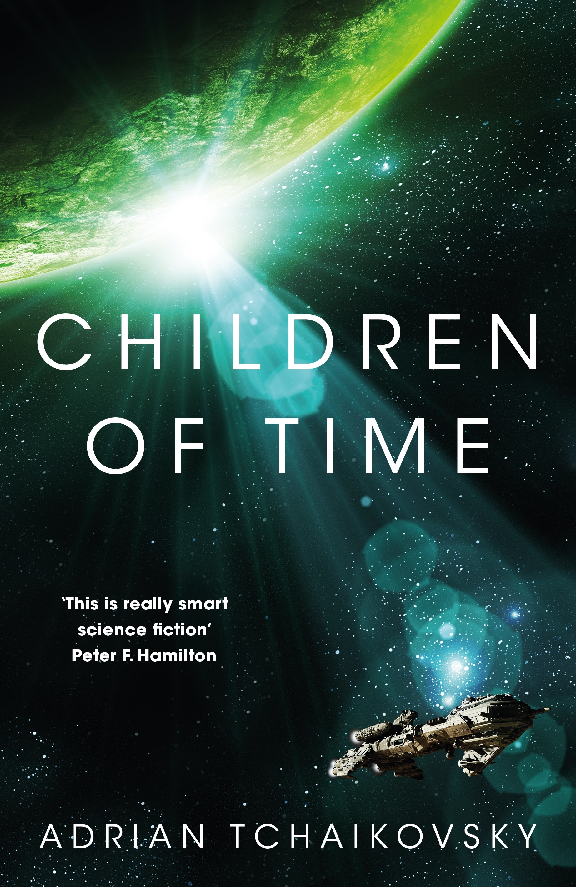

> _This will be the first of a thousand worlds that we will give life to. For we
> are gods, and we are lonely, so we shall create._

:::tip[Opinión]

Children of [...] es una serie de libros todos situados en el mismo universo. El
primero de ellos es Children of Time, seguido por Children of Ruin, Children of
Memory, y una reciente adición, Children of Strife.

A diferencia de los libros de Hamilton[2](#note-2), la saga de
Children es bastante llevadera y fácil de leer. El primer libro es realmente
divertido, entretenido, y de cierta forma "refrescante" debido al escenario que
plantea, que difiere un poco del típico escenario Sci-Fi.

**LINTER-PUNTAJE:** les doy 🕷️🕷️🕷️🕷️🕷️🕷️🕷️🕷️🕷️ arañas sobre 5 linternitas

:::

Sinopsis

La humanidad comienza a dar sus primeros pasos de colonización espacial, dándose
inicio a una fase de terraformación de planetas.

Avarana Kern, una de las líderes del proyecto de terraformación, decide que,
además de poblar los planetas con vida, quiere experimentar con la misma. Así es
como desarrollan un virus capaz de exaltar la inteligencia de una especie, con
el objetivo de aplicarlo en primates y "ver qué pasa".

Las cosas no salen de acuerdo al
🕷️🕷️🕷️🕷️🕷️🕷️🕷️🕷️🕷️🕷️🕷️🕷️🕷️🕷️🕷️🕷️🕷️🕷️🕷️🕷️🕷️🕷️🕷️🕷️🕷️🕷️🕷️🕷️🕷️🕷️🕷️🕷️🕷️🕷️🕷️🕷️🕷️🕷️🕷️🕷️🕷️🕷️🕷️🕷️🕷️🕷️🕷️🕷️🕷️🕷️🕷️🕷️🕷️🕷️🕷️🕷️🕷️🕷️🕷️🕷️🕷️🕷️🕷️🕷️🕷️🕷️🕷️🕷️🕷️🕷️🕷️🕷️🕷️🕷️🕷️🕷️🕷️

[Children of Time en Goodreads](https://www.goodreads.com/book/show/25499718-children-of-time)

[Children of Time (Series) en Goodreads](https://www.goodreads.com/series/247630-children-of-time)

<Note noteIndex="2">
  Recién ahora veo la portada de Children of Time y me doy cuenta que hay un
  comentario del mismísimo Hamilton ahí. No tenía idea.
</Note>

## Becky Chambers

### Wayfarers (Serie)

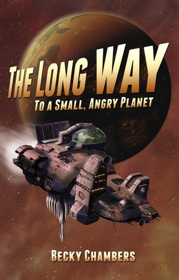

> _“The fact that you people have been playing this for centuries says a lot
> about your species.”_
>
> _“Oh? What’s it say?”_
>
> _“That Humans make everything needlessly difficult.”_

:::tip[Opinión]

Si Children of [...] es llevadera, diría que los libros de Becky lo son todavía
más.

No hay que confundir esto de "llevadero" con simpleza o con falta de
profundidad. Más que nada me refiero a la forma en que los libros están escritos
y cómo Becky transmite lo que quiere transmitir de forma fácil.

En sí, sus libros están más que nada centrados en los personajes y las
dificultades que cada uno atraviesa.

Becky se volvió una de mis autoras favoritas y de las pocas a las que sigo y
pacientemente espero que publiquen nuevas cosas.

Wayfarers es una serie compuesta por:

- The Long Way to a Small, Angry Planet
- A Closed and Common Orbit
- Record of a Spaceborn Few
- The Galaxy, and the Ground Within

Cada libro de la serie se encuentra situado en el mismo universo, pero tratan
sobre temas y personajes distintos.

**LINTER-PUNTAJE:** 🟣🟢🔵🟣🟣🟣🟠🟠🟠🟠🟤🟤🟡🔴🔴/🔦

:::

Sinopsis

Esta sinopsis aplica al primer libro, The Galaxy, and the Ground Within.

Rosemary, una humana oriunda de Marte, se suma a la diversa tripulación del
_Wayfarer_ (compuesta por humanos y aliens), una nave atada con alambre que
trabaja abriendo agujeros de gusano para establecer conexiones entre sistemas
solares.

Es la primera vez que Rosemary se embarca en algo como esto, teniendo que
adaptarse a los aliens, aprendiendo cómo viven y cuáles son sus costumbres.

Para abrir un agujero de gusano entre dos ubicaciones, tienen que viajar hasta
las mismas.

Al _Wayfarer_ se le asigna la tarea de abrir un agujero de gusano en un planeta
extremadamente lejano.

En el largo viaje, la tripulación experimenta diferentes crisis y problemas que
intentan resolver.

[Wayfarers (Series) en Goodreads](https://www.goodreads.com/series/170872-wayfarers)

### Monk and Robot (serie)

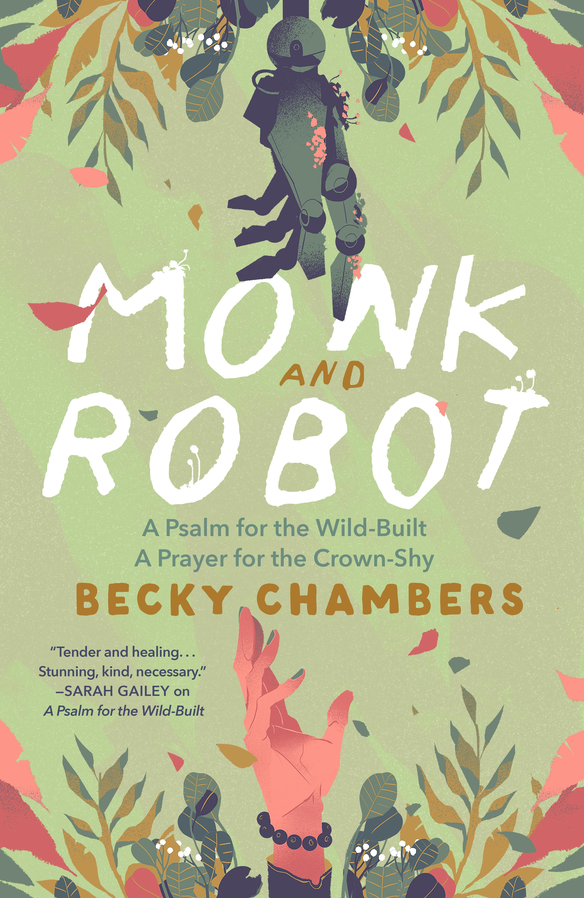

> _You keep asking why your work is not enough, and I don’t know how to answer
> that, because it is enough to exist in the world and marvel at it. You don’t
> need to justify that, or earn it. You are allowed to just live._

:::tip[Opinión]

Estos dos libros son novelas cortas. A diferencia de los anteriores, si bien hay
elementos de ciencia ficción, no es lo prevalente o lo que más destaca de la
historia. Tampoco tenemos un elenco con múltiples personajes.

En líneas generales, la historia habla sobre el propósito en nuestras vidas y
cómo nos relacionamos con otros.

Monk and Robot es una serie compuesta por:

- A Psalm for the Wild-Built
- A Prayer for the Crown-Shy

**LINTER-PUNTAJE:** le doy 50 tazas de té servidas y compartidas con otros

:::

Sinopsis

Dex es un monje que se dedica a servir té y escuchar los problemas de la gente,
como si fuera una suerte de terapista.

Cansado de la rutina decide abandonar su profesión y recorrer el mundo. En su
viaje, se encuentra con algo que la humanidad pensaba extinto: un robot
consciente.

[Monk and Robot (Series) en Goodreads](https://www.goodreads.com/series/239322-monk-and-robot)

## Arkady Martine

### A Memory Called Empire & A Desolation Called Peace

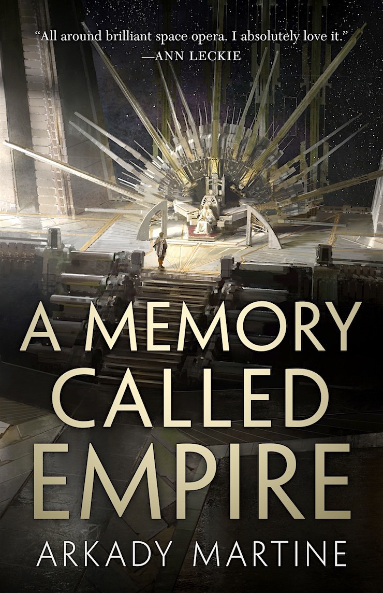

> _“Her Excellency, the ezuazuacat Nineteen Adze,” Three Seagrass went on, and
> then murmured, “whose gracious presence illuminates the room like the
> edgeshine of a knife,”_

:::tip[Opinión]

A Memory Called Empire es la primera novela de Arkady Martine. Ganó el premio
Hugo en 2020.

La secuela, A Desolation Called Peace, es su segunda novela. Ganó el premio Hugo
en 2022.

No es que importe tanto. Fijarse en los premios que gana algo para decir si es
bueno o malo es un poco absurdo. Es como solo escuchar música que haya ganado
premios Grammy. Pero a lo que voy es que tuvieron una muy buena recepción.

Lo que más me llamó la atención de este libro es lo "peculiar" que es. En
palabras de un amigo: "es como si estuvieran hablando de un imperio Azteca
intergaláctico".

**LINTER-PUNTAJE:** le doy una gran sonrisa de ojo a ojo :)

:::

Sinopsis

Lsel es una pequeña estación espacial en las afueras del imperio Teixcalaanli.
Hasta ahora, lograron evitar ser anexados y mantener su cultura y forma de vida.

Mahit es enviada a la capital del imperio como embajadora de Lsel. Al llegar, se
encuentra con que su predecesor fue asesinado, y que su vida también corre
peligro.

¿Qué pasa cuando una cultura se impone sobre otra? ¿Qué podés hacer si te
enfrentás contra un poder sumamente mayor, al cual no tenés chances de ganarle?

En palabras de la autora, este libro está dedicado a "cualquier persona que haya
amado alguna vez a una cultura que absorbe la suya propia".

[A Memory Called Empire en Goodreads](https://www.goodreads.com/book/show/37794149-a-memory-called-empire)

[A Desolation Called Peace en Goodreads](https://www.goodreads.com/book/show/45154547-a-desolation-called-peace)

## Isaac Asimov

### Foundation (serie)

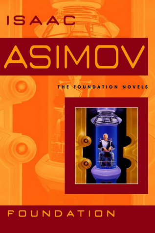

> _The fall of Empire, gentlemen, is a massive thing, however, and not easily
> fought. It is dictated by a rising bureaucracy, a receding initiative, a
> freezing of caste, a damming of curiosity—a hundred other factors. It has been
> going on, as I have said, for centuries, and it is too majestic and massive a
> movement to stop_

:::tip[Opinión]

¿Harto de la ciencia ficción moderna? ¿Odiás a Becky Chambers y querés ver qué
se escribía hace casi un siglo atrás? Asimov es para vos.

Asimov es uno de los pilares de la ciencia ficción. Incluso aunque no hayas
leído activamente alguna de sus obras, seguramente fuiste expuesto de forma
indirecta. Muchas obras referencian (o parodian) cosas de sus libros.

Si bien esta entrada dice solo "Foundation", en realidad me estoy refiriendo a
_todos_ los libros que se pueden considerar dentro de la saga. Esto incluye:

- La serie de Robots
- La serie del Imperio Galáctico
- La serie de Fundación

Estamos hablando de, mínimo, 17 obras/libros. Lo cual puede parecer un montón,
pero realmente está bueno y si leés toda la historia cierra de forma
satisfactoria.

Lo que recomendaría, antes de empezar a leer los 17 libros, es solamente
centrarse en la trilogía original de Fundación, compuesta por:

- Foundation
- Foundation and Empire
- Second Foundation

De más está decir que soy fanático de Asimov y sus libros.

**LINTER-PUNTAJE:** le doy las 3 leyes de la robótica 🤖

:::

Sinopsis

Esta sinopsis es sobre Fundación, el primer libro de la trilogía.

Hari Seldon es el creador de la _psicohistoria_, una rama de la ciencia que
puede utilizarse "mirar" lo que va a pasar en el futuro.

Y lo que va a pasar no está bueno: el grandísimo Imperio Galáctico que dominó la
galaxia por 12 mil años está por terminar, cayendo toda la galaxia en una época
oscura que duraría 30 mil años.

Seldon asegura tener un plan que, si bien no evitaría que el Imperio caiga,
reduciría la crisis a tan solo mil años, al final de los cuales un nuevo imperio
surgirá de las cenizas del anterior.

[Foundation Trilogy en Goodreads](https://www.goodreads.com/book/show/46654.The_Foundation_Trilogy)

### The End of Eternity

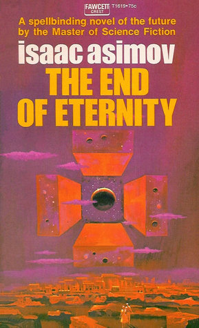

> _But emotion had come upon him after all. Not for fifty billion people. What
> in Time did he care for fifty billion people? There was just one. One person._

:::tip[Opinión]

Este libro no está relacionado con Fundación.

Bueno, más o menos. Algunos alegan que sí. Pero la conexión es muy leve y algo
tirada de los pelos.

Así que si _no_ querés embarcarte en la odisea de leer todos los libros del
universo de Fundación, pero aún así querés leer algo de Asimov, recomiendo
altamente leer este.

O cualquier otro libro de Asimov, son generalmente buenos.

**LINTER-PUNTAJE:** le doy... las gracias...

:::

Sinopsis

Andrew Harlan trabaja para Eternity, una organización capaz de alterar el tiempo
y de poder "viajar" a diferentes puntos en el futuro.

El objetivo de Eternity es monitorear el futuro de la humanidad y hacer
correcciones necesarias para asegurar la felicidad de la especie humana.

Harlan se enamora de una mujer que no pertenece a Eternity.

[The End of Eternity](https://www.goodreads.com/book/show/509784.The_End_of_Eternity)

## Robert Charles Wilson

### Spin

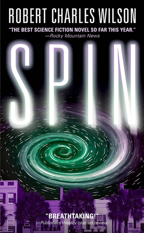

:::tip[Opinión]

Es un buen libro.

**LINTER-PUNTAJE:** le doy un deberías leerlo

:::

Sinopsis

De un momento para otro, el planeta entero se ve envuelto en un manto de
oscuridad. Las estrellas desaparecen por completo, aunque todavía se siente el
efecto del calor del Sol y el empuje gravitacional de la Luna.

Fuera de este manto o barrera, el tiempo transcurre más rápido que adentro: cada
24 horas en la Tierra pasan millones de años afuera.

Los habitantes del planeta temen que, a este ritmo, solo les queda 40 años hasta
que el Sol "muera".

[Spin en Goodreads](https://www.goodreads.com/book/show/910863.Spin)

## Otros libros que consideré buenos

Pero no tanto en comparación con los anteriores:

- [All Our Wrong Todays en Goodreads](https://www.goodreads.com/book/show/27405006-all-our-wrong-todays)
- [The Gone World en Goodreads](https://www.goodreads.com/book/show/33413556-the-gone-world)
